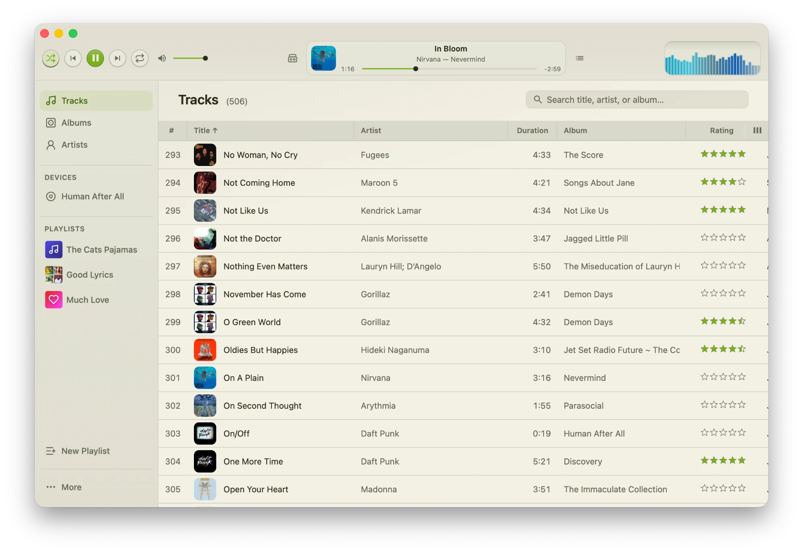
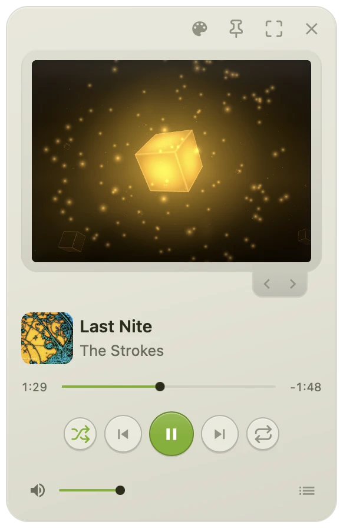
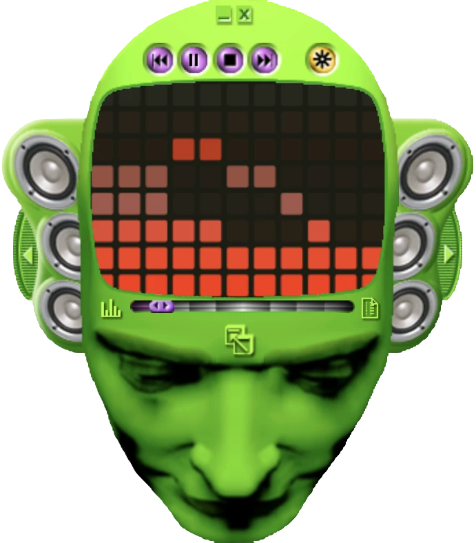
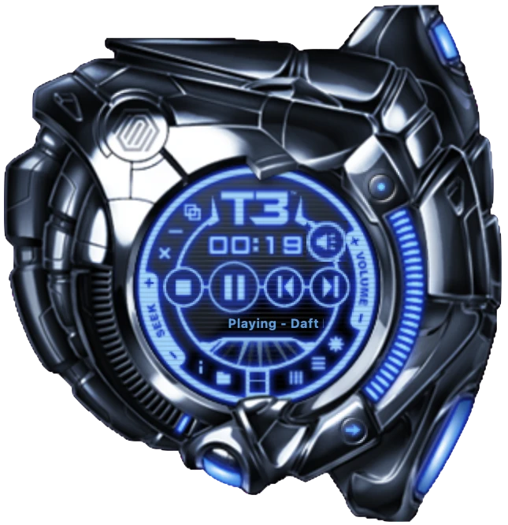
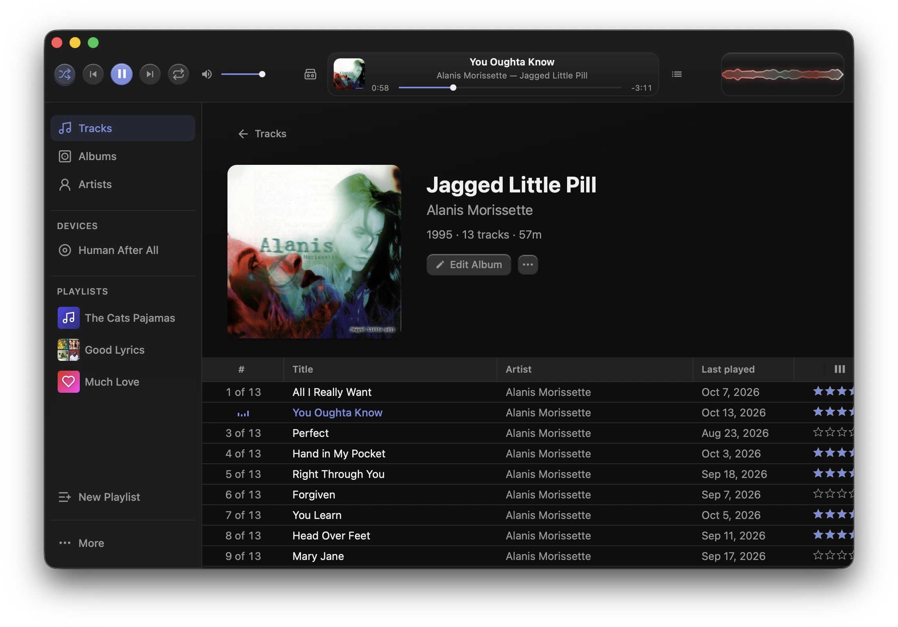

<div align="center">

<a href="https://spiralpowered.com">
  <picture>
    <source media="(prefers-color-scheme: dark)" srcset=".github/assets/logo-dark.svg">
    
  </picture>
</a>

# Spiral

### Reclaim your music.

A free, open source desktop music experience.<br>
No ads. No algorithms. No tracking. No internet required. Just your collection, organized and played in style.

<!-- Badges: add or remove freely, one per line keeps diffs readable -->
[](https://github.com/brpowell/spiral/releases/latest)
[](https://github.com/brpowell/spiral/actions/workflows/desktop-test.yml)
[](https://github.com/brpowell/spiral/actions/workflows/registry-ci.yml)
[](LICENSE)
[](#install)
[](https://ko-fi.com/brpowell)

**[Download](https://github.com/brpowell/spiral/releases/latest)** &nbsp;·&nbsp;
**[Website](https://spiralpowered.com)** &nbsp;·&nbsp;
**[Contribute](CONTRIBUTING.md)** &nbsp;·&nbsp;
**[Support the project](#support)**

<br>

<picture>
  <source media="(prefers-color-scheme: dark)" srcset=".github/assets/hero-dark.webp">
  
</picture>

</div>

## Why

There's a funny paradox that comes with unlimited access to infinite music.

Streaming anything you want at anytime is obviously great. At the same time, when it's delivered like a firehose, it feels cheap and disposable. You know what I'm talking about. I know you scroll on Netflix, or any one of these things, only to choose nothing at least once a week. Access to everything but nothing is yours.

Spiral is for the other way of listening: buying albums, ripping your CDs, curating music by hand, and caring about the songs you have privately. Think of the media players you grew up with or have [anemoia](https://en.wikipedia.org/wiki/Anemoia) for, redesigned with today's tools: fast, local-first, and made to be personalized.

A delightful music experience doesn't need to have all the songs. Marinating in the ones you own is its own special kind of thing.

## Features

- 📚 **Your library, organized**: Hand Spiral your files - it probes and organizes your files while tracking everything in an offline database. Playlist, artist images, and album images are also neatly organized in your library folder.
- 💿 **CD ripping**: Insert a disc, pull metadata from MusicBrainz, and rip to any of our supported codecs. Your shelf becomes your library.
- 🏷️ **Metadata editing**: Fix tags, swap album art and rename tracks. Your music stays portable.
- 🎶 **Playlists**: Build them the old-fashioned way by hand. I'm planning to thoughtfully expand this later.
- 🎛️ **Equalizer**: Shape your sound with a band-by-band EQ in its own window.
- 📝 **Synced lyrics**: Fetch time-synced lyrics from [LRCLIB](https://lrclib.net) and follow along as the song plays. Lyrics are saved as `.lrc` files next to your tracks, so they stay portable.
- 🌈 **Visualizers**: Canvas2D and WebGL powered audio visuals that make it fun to stare at your music.
- 🎨 **Themes and skins**: Restyle the whole app, or jump into skin mode for a player-focused experience.
- 🔒 **Private by design**: No account, no telemetry, no ads. Your listening habits stay on your machine.

## Make it yours

Swap the whole app with a theme, or jump into skin mode for a compact, player-focused experience. Use the built-in pack system to install and create your own.

> 💡 A design kit to help build custom skins, visualizers, and more is in development.

<div align="center">

<picture>
  <source media="(prefers-color-scheme: dark)" srcset=".github/assets/skin-vanilla-dark.webp">
  
</picture>
&nbsp;

&nbsp;

<br>
<sub><b>Vanilla</b> &nbsp;·&nbsp; <b>Headspace</b>* &nbsp;·&nbsp; <b>T3</b>*</sub>
<br>
<sub>*Ports of classic Windows Media Player skins, with all credit to their original designers. Spiral is not affiliated with or endorsed by Microsoft.</sub>

<br>


<br>
<sub><b>Obsidian</b>, a dark theme with a cool blue accent</sub>

</div>

## Install

Grab the build for your platform from the **[latest release](https://github.com/brpowell/spiral/releases/latest)**. Once installed, Spiral keeps itself up to date.

<details>
<summary><b>macOS</b> &nbsp;<code>.dmg</code>, universal (Apple Silicon and Intel)</summary>
<br>

Builds are not yet signed or notarized by Apple, so macOS may say *"Spiral" is damaged and can't be opened.* The file is fine, I'm working on this. After dragging Spiral to Applications, clear the download quarantine flag and open it again:

```bash
xattr -cr /Applications/Spiral.app
```

</details>

<details>
<summary><b>Windows</b> &nbsp;<code>-setup.exe</code>, x64 and ARM64</summary>
<br>

Windows SmartScreen may warn about an unrecognized app. Choose **More info**, then **Run anyway**.

</details>

<details>
<summary><b>Linux</b> &nbsp;<code>.AppImage</code>, <code>.deb</code> or <code>.rpm</code>, x86_64 and aarch64</summary>
<br>

For the AppImage, `chmod +x` the file and run it. Install the others with `sudo apt install ./Spiral_*.deb` or `sudo dnf install ./Spiral-*.rpm`.

</details>

## Support

Spiral is free, open source, and developed with my time. If you love what's going on here, contributing would mean a lot!

[](https://ko-fi.com/brpowell)

If you're not into throwing money at strangers over the internet, I feel you. Starring the repo or sharing also helps.

Supporting your favorite artists and local retailers by purchasing merch, records, and tickets is also cool. This helps the project spiritually.

## For developers

This repository holds the app, the pack registry behind its theme and skin library, and the pack format they share.

| Path | What it is | License |
| --- | --- | --- |
| [`apps/desktop`](apps/desktop) | The Spiral app: Tauri 2, React + TypeScript frontend, Rust backend | Apache-2.0 |
| [`apps/registry`](apps/registry) | `spk-registry`, the Axum service that serves published packs and their catalog | Apache-2.0 |
| [`libs/spk-format`](libs/spk-format) | The `.spk` pack format: manifest schema, validation, and archive extract/write | MIT OR Apache-2.0 |

Packs (`.spk`) are zip archives that add themes, skins, visualizers and sounds to the app. `spk-format` is the single source of truth for what a valid pack is, and both the app and the registry validate with it.

### Build from source

You need a stable [Rust](https://rustup.rs) toolchain and Node.js 22. The desktop app also needs the platform libraries Tauri requires; see the [Tauri prerequisites](https://v2.tauri.app/start/prerequisites/).

```bash
# Desktop app
cd apps/desktop
npm install
npm run tauri dev

# Registry (listens on 127.0.0.1:8787)
cd apps/registry
cargo run

# Pack format
cargo test -p spk-format
```

Each component has its own README with more detail. The repository is a single Cargo workspace, so `cargo test -p <crate>` works from the root.

## Contributing

At the moment, only contributors can file pull requests and issues, while [Ko-fi supporters](https://ko-fi.com/brpowell) can do the latter.

I plan to lax this later, but with the AI hive mind these days I'm not ready yet. Thank you for understanding!

To report a security problem, follow [SECURITY.md](SECURITY.md).

## License

The repository is licensed under the [Apache License 2.0](LICENSE). `libs/spk-format` is dual-licensed under MIT OR Apache-2.0 so other tools can adopt the pack format freely. Third-party notices for the desktop app are in [`apps/desktop/src-tauri/NOTICE`](apps/desktop/src-tauri/NOTICE).

<div align="center">
<br>
<picture>
  <source media="(prefers-color-scheme: dark)" srcset=".github/assets/logo-dark.svg">
  
</picture>
<br>
<sub>Listen to albums</sub>
</div>
